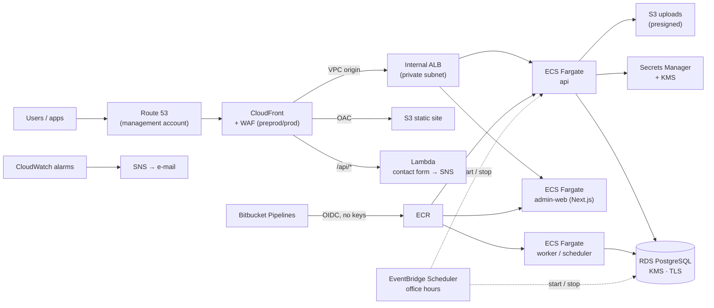

# AWS platform on ECS Fargate — Terraform

Production-grade AWS infrastructure for a containerised web platform (Go API + workers, Next.js
admin panel, static marketing site, PostgreSQL), built with Terraform and deployed through a
keyless OIDC pipeline. Primary Region Asia Pacific (Mumbai) `ap-south-1`, DR to Asia Pacific
(Hyderabad) `ap-south-2`.

> **Portfolio copy.** This is a sanitised version of a real client engagement. Company and
> product names, domains, e-mail addresses, Bitbucket workspace/repository UUIDs and API keys
> have been replaced with placeholders (`acme`, `example.com`, `your-workspace`, …). The
> architecture, modules and pipeline are unchanged.

## Highlights

- **Multi-account landing zone**: management + one AWS account per environment, Identity Center
  with MFA, no IAM users or access keys anywhere.
- **Private origin**: internal ALB reached only through a CloudFront **VPC origin**; nothing
  public to bypass the edge.
- **ECS Fargate (ARM64)** services from one image: `api`, `worker`, `scheduler`, plus a
  Next.js `admin-web` service. Secrets injected from Secrets Manager, written with
  write-only arguments so they never land in state.
- **RDS PostgreSQL** with KMS, TLS, automatic master-password rotation, one-off `db-ops` task for
  admin SQL (no bastion).
- **Keyless CI/CD**: Bitbucket Pipelines → OIDC → least-privilege IAM roles per repository and
  per deployment environment (`sub` = `{repo}:{env}:{step}`). Terraform plans on every PR and
  applies the saved plan after merge.
- **Cost control**: dev runs office hours only (EventBridge Scheduler stops ECS + RDS), budgets,
  no NAT gateway in dev (≈ $74/month for the whole dev environment).
- **Operations**: CloudWatch alarms (5xx, unhealthy targets, RDS CPU/storage, ERROR log
  counts) → SNS e-mail; every resource tagged.

## Architecture



| Document | What's in it |
|---|---|
| [`docs/ARCHITECTURE.md`](docs/ARCHITECTURE.md) | the full design: accounts, identity, network, environments, DR, decisions |
| [`docs/ROADMAP.md`](docs/ROADMAP.md) | build phases with checkboxes (what was built, in which order) |

## Environments

| Environment | AWS account | Folder | Status |
|---|---|---|---|
| Management | acme-management | – (no workloads) | ✅ created |
| Dev | acme-dev | [`envs/dev`](envs/dev/README.md) | ✅ api + admin web live, CI/CD, alarms |
| Pre-prod | acme-preprod | [`envs/preprod`](envs/preprod/README.md) | ⏳ designed, not built |
| Prod | acme-prod | [`envs/prod`](envs/prod/README.md) | ⏳ designed, not built |

Account IDs are **not** stored in this repo:
- Local: `envs/<env>/.env.<env>` (git-ignored) sets `AWS_PROFILE` and `TF_VAR_aws_account_id`
- Pipeline: Bitbucket secured variables (`DEV_AWS_ACCOUNT_ID`, …)

## Repository layout

```
modules/            reusable building blocks
  network/          VPC, 3 subnet tiers × 2 AZs, IGW, optional NAT, S3 endpoint
  security/         security groups (SG-to-SG), KMS key, Secrets Manager (write-only values)
  database/         RDS PostgreSQL + PostGIS, parameter group, rotation
  db-ops-task/      one-off psql task on Fargate (admin SQL, migrations)
  ecr/              repositories with KMS, immutable tags, lifecycle policy
  ecs-cluster/      Fargate cluster
  ecs-service/      task definition + service, roles, log group, secrets injection
  alb/              internal ALB, HTTPS listener, SNI certs, host-header routing
  cloudfront-alb/   CloudFront distribution with a VPC origin to the ALB
  acm-certificate/  DNS-validated certificates (us-east-1 for CloudFront)
  ci-oidc/          Bitbucket OIDC provider + per-repo push/deploy/plan/apply roles
  env-scheduler/    EventBridge Scheduler: start/stop ECS services and RDS on a cron
  budget/           AWS Budgets with actual + forecast alerts
  alarms/           CloudWatch alarms + metric filters → SNS
  s3-uploads/       private bucket for presigned uploads, CORS, lifecycle
  static-site/      S3 + CloudFront static site with a rewrite function
  site-form/        Lambda (function URL, IAM auth) → SNS for contact forms
envs/dev/           dev root module    → one state → acme-dev account
envs/preprod/       pre-prod root module (design only)
envs/prod/          prod root module (design only)
docs/               architecture and roadmap
bitbucket-pipelines.yml   plan on PR, manual apply of the saved plan after merge
```

The same modules are used by every environment. Only the variables in
`envs/<env>/terraform.tfvars` change (sizes, AZ count, NAT count, Multi-AZ, schedules).

## Prerequisites

- Terraform ≥ 1.11 (pipeline pins 1.16.4), AWS CLI v2
- Access through IAM Identity Center (`aws configure sso`; session `acme`, profile `acme-<env>`)

## How to run (dev)

Changes reach dev **only through the pipeline**. From a laptop: `plan` to check your change.

```bash
cd envs/dev
source .env.dev
aws sso login --sso-session acme
terraform init -backend-config="bucket=acme-dev-tfstate-${TF_VAR_aws_account_id}"
terraform fmt -recursive ../..
terraform validate
terraform plan
```

## Workflow

1. Branch from an up-to-date `main`: `feature/<short-name>`
2. Pull Request to `main` → pipeline: `fmt -check`, `validate`, `plan` (read-only role).
   Read the plan (step log or the `plan.txt` artifact)
3. Merge → pipeline: `plan` + manual `apply` of that saved plan to **dev** (apply role, `dev` deployment)
4. Pre-prod and prod: Bitbucket **Deployments**, manual, with approvals *(later)*

Pipeline variables: repository `DEV_AWS_ACCOUNT_ID`, `DEV_TF_PLAN_ROLE_ARN`; dev deployment
`TF_APPLY_ROLE_ARN` (all secured).

## Rules

- **No changes in the AWS console.** Every change goes through Terraform and git.
- **Read the `plan` before every `apply`.** Stop on "must be replaced" for databases.
- **Never commit** secrets, `.env*`, `.tfstate`, plan files. Secrets live in AWS Secrets Manager.
- **Commit `.terraform.lock.hcl`.**
- Tags on everything: `Project=acme`, `Env=<env>`, `ManagedBy=terraform`.
