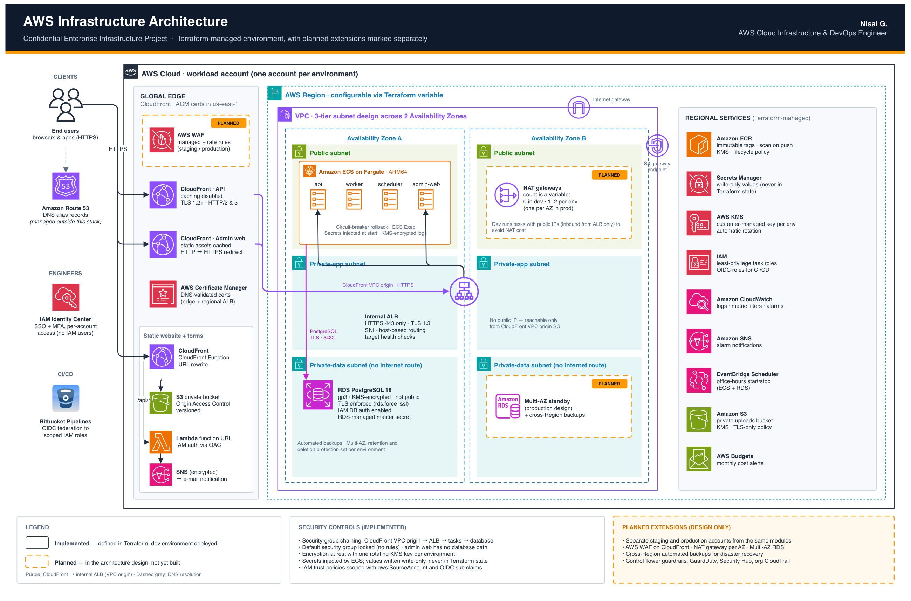
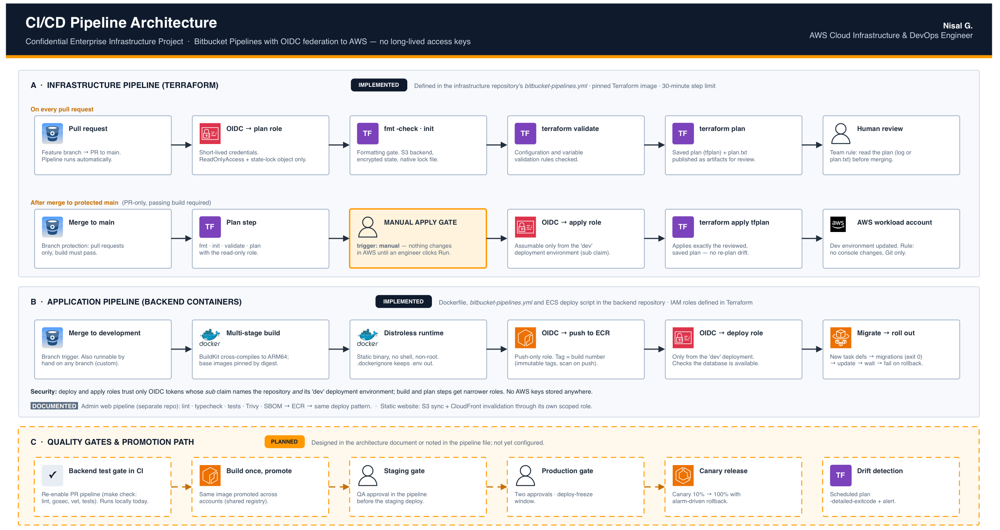
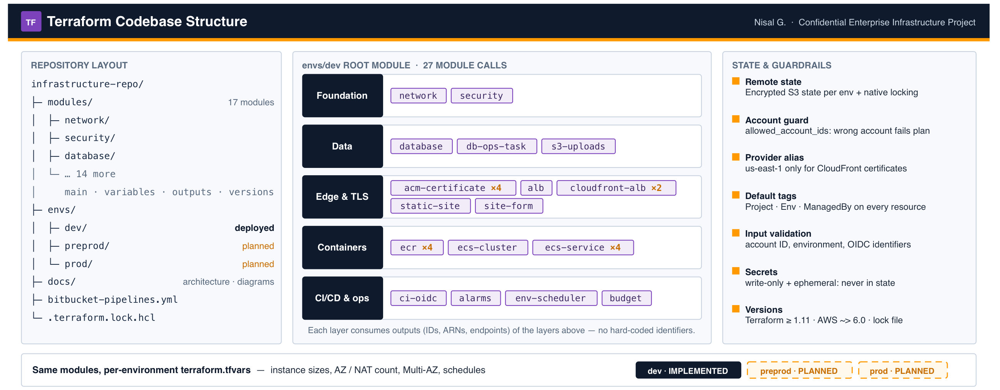
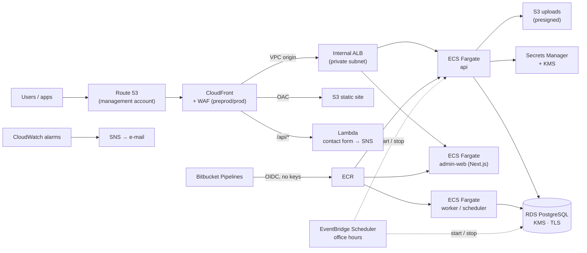

# AWS platform on ECS Fargate — Terraform

Production-grade AWS infrastructure for a containerised web platform (Go API + workers, Next.js
admin panel, static marketing site, PostgreSQL), built with Terraform and deployed through a
keyless OIDC pipeline. Primary Region Asia Pacific (Mumbai) `ap-south-1`, DR to Asia Pacific
(Hyderabad) `ap-south-2`.

> **Portfolio copy.** This is a sanitised version of a real client engagement. Company and
> product names, domains, e-mail addresses, Bitbucket workspace/repository UUIDs and API keys
> have been replaced with placeholders (`acme`, `example.com`, `your-workspace`, …). The
> architecture, modules and pipeline are unchanged.

## Highlights

- **Multi-account landing zone**: management + one AWS account per environment, Identity Center
  with MFA, no IAM users or access keys anywhere.
- **Private origin**: internal ALB reached only through a CloudFront **VPC origin**; nothing
  public to bypass the edge.
- **ECS Fargate (ARM64)** services from one image: `api`, `worker`, `scheduler`, plus a
  Next.js `admin-web` service. Secrets injected from Secrets Manager, written with
  write-only arguments so they never land in state.
- **RDS PostgreSQL** with KMS, TLS, automatic master-password rotation, one-off `db-ops` task for
  admin SQL (no bastion).
- **Keyless CI/CD**: Bitbucket Pipelines → OIDC → least-privilege IAM roles per repository and
  per deployment environment (`sub` = `{repo}:{env}:{step}`). Terraform plans on every PR and
  applies the saved plan after merge.
- **Three environments from one module set**: dev, pre-prod and prod differ only in
  `terraform.tfvars`. Pre-prod and prod add WAF per distribution, Application Auto Scaling
  with a scheduled peak floor, Multi-AZ RDS with 35-day PITR and **cross-Region automated
  backups to Hyderabad** (RPO ≈ 5 min).
- **Cost control**: dev and pre-prod run office hours only (EventBridge Scheduler and
  scheduled scaling stop ECS + RDS), budgets per account, no NAT gateway in dev
  (≈ $74/month for the whole dev environment).
- **Operations**: CloudWatch alarms (5xx, unhealthy targets, RDS CPU/storage, ERROR log
  counts) → SNS e-mail; nightly drift check; every resource tagged.

## Architecture

<p align="center">
  <a href="docs/2_AWS_Architecture_Diagram.pdf"></a>
</p>

> The diagrams were drawn when only dev was live, so pre-prod, prod, WAF and cross-Region
> backups are marked *planned* in them. Their Terraform has since been written: see
> [`envs/preprod`](envs/preprod/README.md) and [`envs/prod`](envs/prod/README.md).

### CI/CD

<p align="center">
  <a href="docs/3_CICD_Pipeline_Diagram.pdf"></a>
</p>

### Terraform codebase

<p align="center">
  <a href="docs/4_Terraform_Codebase_Diagram.pdf"></a>
</p>

<details>
<summary>Text version of the architecture (Mermaid)</summary>



</details>

| Document | What's in it |
|---|---|
| [`docs/1_AWS_Infrastructure_Case_Study.pdf`](docs/1_AWS_Infrastructure_Case_Study.pdf) | three-page case study: objectives, services, Terraform design, CI/CD, security, cost, outcomes |
| [`docs/2_AWS_Architecture_Diagram.pdf`](docs/2_AWS_Architecture_Diagram.pdf) · [`3_CICD_Pipeline_Diagram.pdf`](docs/3_CICD_Pipeline_Diagram.pdf) · [`4_Terraform_Codebase_Diagram.pdf`](docs/4_Terraform_Codebase_Diagram.pdf) | the three diagrams above as PDFs (PNG renders in [`docs/images/`](docs/images/)) |
| [`docs/ARCHITECTURE.md`](docs/ARCHITECTURE.md) | the full design: accounts, identity, network, environments, DR, decisions |
| [`docs/ROADMAP.md`](docs/ROADMAP.md) | build phases with checkboxes (what was built, in which order) |

## Environments

| Environment | AWS account | Folder | Status |
|---|---|---|---|
| Management | acme-management | – (no workloads) | ✅ created |
| Dev | acme-dev | [`envs/dev`](envs/dev/README.md) | ✅ api + admin web live, CI/CD, alarms |
| Pre-prod | acme-preprod | [`envs/preprod`](envs/preprod/README.md) | 🧩 Terraform complete and validated; account pending (Control Tower) |
| Prod | acme-prod | [`envs/prod`](envs/prod/README.md) | 🧩 Terraform complete and validated; account pending (Control Tower) |

What the three roots share and where they differ (all from the same modules):

| | dev | preprod | prod |
|---|---|---|---|
| ECS tasks | public subnet, public IP, 1 AZ, no NAT | private subnets, 2 AZs, 1 NAT | private subnets, 2 AZs, 2 NAT (one per AZ) |
| Scaling | fixed count | auto scaling on CPU (api 2–4) | auto scaling on CPU (api 2–8) + peak floor 4 at 15:30–17:30 |
| Hours | weekdays 08–20 (EventBridge Scheduler) | weekdays 07–21 (scheduled scaling to 0/0 + RDS stop) | 24/7 |
| WAF | – | per distribution, count mode first; admin panel IP-restricted | per distribution, block mode |
| RDS | t4g.micro, 1-day backups | t4g.medium, 7-day backups, deletion protection | t4g.large **Multi-AZ**, 35-day PITR, **cross-Region backups to Hyderabad** |
| Retention | 7-day logs | 30-day logs | 90-day logs, Container Insights enhanced |
| Budget | $100 | $250 | $1,000 |

Account IDs are **not** stored in this repo:
- Local: `envs/<env>/.env.<env>` (git-ignored) sets `AWS_PROFILE` and `TF_VAR_aws_account_id`
- Pipeline: Bitbucket secured variables (`DEV_AWS_ACCOUNT_ID`, `PREPROD_AWS_ACCOUNT_ID`, `PROD_AWS_ACCOUNT_ID`)

## Repository layout

```
modules/            reusable building blocks
  network/          VPC, 3 subnet tiers × 2 AZs, IGW, optional NAT, S3 endpoint
  security/         security groups (SG-to-SG), KMS key, Secrets Manager (write-only values)
  database/         RDS PostgreSQL + PostGIS, parameter group, rotation
  db-ops-task/      one-off psql task on Fargate (admin SQL, migrations)
  ecr/              repositories with KMS, immutable tags, lifecycle policy
  ecs-cluster/      Fargate cluster
  ecs-service/      task definition + service, roles, log group, secrets injection
  ecs-autoscaling/  Application Auto Scaling: CPU/memory/request targets + scheduled min/max
  alb/              internal ALB, HTTPS listener, SNI certs, host-header routing
  cloudfront-alb/   CloudFront distribution with a VPC origin to the ALB
  waf/              WAFv2 web ACL for CloudFront: allow-list, geo, rate limit, AWS managed rules, logs
  acm-certificate/  DNS-validated certificates (us-east-1 for CloudFront)
  ci-oidc/          Bitbucket OIDC provider + per-repo push/deploy/plan/apply roles
  env-scheduler/    EventBridge Scheduler: start/stop ECS services and RDS on a cron
  db-dr-backups/    RDS cross-Region automated backups + KMS key in the DR Region
  budget/           AWS Budgets with actual + forecast alerts
  alarms/           CloudWatch alarms + metric filters → SNS
  s3-uploads/       private bucket for presigned uploads, CORS, lifecycle
  static-site/      S3 + CloudFront static site with a rewrite function
  site-form/        Lambda (function URL, IAM auth) → SNS for contact forms
envs/dev/           dev root module      → one state → acme-dev account
envs/preprod/       pre-prod root module → one state → acme-preprod account
envs/prod/          prod root module     → one state → acme-prod account (+ DR Region provider)
docs/               architecture and roadmap
bitbucket-pipelines.yml   three plans on every PR; after merge, manual applies dev → preprod → prod
```

The same modules are used by every environment. Only the variables in
`envs/<env>/terraform.tfvars` change (sizes, AZ count, NAT count, Multi-AZ, schedules, WAF mode).
Each environment ships a committed **`terraform.tfvars.example`** with placeholder identifiers
(Bitbucket UUIDs, allow-list IPs, e-mail addresses); the working `terraform.tfvars` is
git-ignored and created from it (`cp terraform.tfvars.example terraform.tfvars`). The pipeline
does the same copy when no `terraform.tfvars` is present. Secrets are never in either file.
`envs/preprod` and `envs/prod` are deliberately kept diff-able: `diff envs/preprod/main.tf envs/prod/main.tf`
shows only the marketing site, the DR backups and the protection flags.

## Prerequisites

- Terraform ≥ 1.11 (pipeline pins 1.16.4), AWS CLI v2
- Access through IAM Identity Center (`aws configure sso`; session `acme`, profile `acme-<env>`)

## How to run

Changes reach every environment **only through the pipeline**. From a laptop: `plan` to check
your change (same for `preprod` and `prod`; the first-time bootstrap of a new account is in that
environment's README).

```bash
cd envs/dev                       # or envs/preprod, envs/prod
source .env.dev
aws sso login --sso-session acme
cp -n terraform.tfvars.example terraform.tfvars   # first time only; then fill in the real identifiers
terraform init -backend-config="bucket=acme-dev-tfstate-${TF_VAR_aws_account_id}"
terraform fmt -recursive ../..
terraform validate
terraform plan
```

## Workflow

1. Branch from an up-to-date `main`: `feature/<short-name>`
2. Pull Request to `main` → pipeline: `fmt -check`, `validate` and **three plans in parallel**
   (dev, preprod, prod; read-only roles). Read them (step log or the `plan.txt` artifacts)
3. Merge → pipeline: the three plans again, then manual applies of those saved plans in order
   **dev → preprod → prod**. Each apply is a Bitbucket Deployment with its own role and
   permissions: dev (DevOps), preprod (QA lead + DevOps), prod (two approvals, admins only,
   no deploys 16:00–10:00)
4. A saved plan is rejected if the state moved in between (another merge): re-run the pipeline.
   The prod plan step refuses to save a plan that replaces or destroys the RDS instance
5. `custom: drift-check` (scheduled nightly) runs `plan -detailed-exitcode` on all three and fails on drift

Pipeline variables (all secured): repository `<ENV>_AWS_ACCOUNT_ID` and `<ENV>_TF_PLAN_ROLE_ARN`
for `DEV`, `PREPROD`, `PROD`; deployment `TF_APPLY_ROLE_ARN` once per deployment.

## Rules

- **No changes in the AWS console.** Every change goes through Terraform and git.
- **Read the `plan` before every `apply`.** Stop on "must be replaced" for databases.
- **Never commit** secrets, `.env*`, `.tfstate`, plan files or `terraform.tfvars` (commit the
  `.example`). Secrets live in AWS Secrets Manager.
- **Commit `.terraform.lock.hcl`.**
- Tags on everything: `Project=acme`, `Env=<env>`, `ManagedBy=terraform`.
