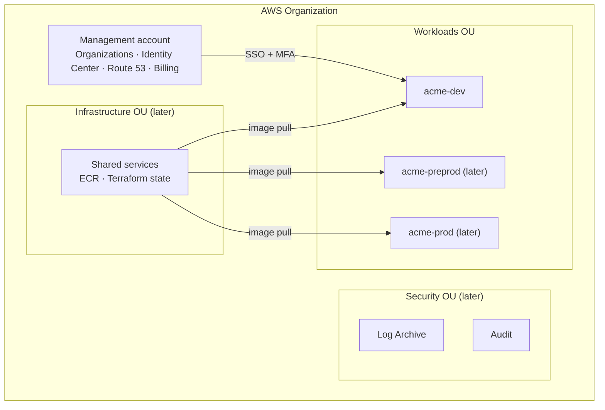

# AWS architecture

Source of truth for the infrastructure design. The platform is a logistics-style workload:
a Go API with background workers, a Next.js admin panel, a static marketing site, and a
PostgreSQL database, all behind CloudFront.

---

## 1. Design targets

| Item | Value |
|---|---|
| Volume | on the order of 1 M API requests/day, with a daily afternoon peak |
| Peak | hundreds of req/s burst; design capacity 1,000 req/s |
| Users | field operators, drivers, customers, merchants, back-office staff |
| Admin Panel | configures every rule the other apps use (users, roles, facilities, routes, prices …) |

---

## 2. Landing zone and accounts



| Account | OU (target) | Purpose |
|---|---|---|
| Acme-Management | Root | Organizations, (later) Control Tower, IAM Identity Center, billing, Route 53 `example.com` |
| Log Archive *(later, Control Tower)* | Security | org CloudTrail + Config logs |
| Audit *(later, Control Tower)* | Security | Security Hub, GuardDuty, Access Analyzer |
| acme-shared *(later)* | Infrastructure | ECR, Terraform state, pipeline roles |
| **acme-dev** | Workloads / NonProd | dev environment |
| acme-preprod *(later)* | Workloads / NonProd | UAT, load tests, release rehearsal |
| acme-prod *(later)* | Workloads / Prod | production + DR to Hyderabad |

**Today:** AWS Organizations + IAM Identity Center are live with the management and dev accounts.
Control Tower is added later on the same organization; `acme-dev` is then enrolled.

Guardrails (target): Region deny (only `ap-south-1`, `ap-south-2`, `us-east-1`), no IAM users or
access keys, no public S3/RDS, CloudTrail/Config/GuardDuty cannot be disabled; Prod OU also
denies deleting RDS, backup vaults and KMS keys.

---

## 3. Identity: two separate sign-ins

| | AWS access | Application access |
|---|---|---|
| Who | DevOps, developers, QA, finance | operators, drivers, support, finance, merchants |
| Sign-in | **IAM Identity Center** (built-in directory, MFA) | application auth (OTP + JWT) |
| Managed in | Identity Center (DevOps) | **Admin Panel** |
| Roles/permissions | permission sets per account | PostgreSQL: roles, permissions, facility/org scope |

Permission sets (target): DevOps = Admin everywhere (prod time-bound); Developers = PowerUser in
dev, ReadOnly in pre-prod, logs only in prod; QA/Product = ReadOnly in dev and pre-prod;
Finance = Billing in management. Pipelines use **Bitbucket OIDC** — no access keys anywhere.

---

## 4. Request path (all environments)

```
Users / apps
  → Route 53 (example.com zone, management account)  ALIAS
  → CloudFront + AWS WAF (ACM certificate in us-east-1)
       ├─ /api/*   not cached  → CloudFront VPC origin → internal ALB → ECS Fargate (api)
       ├─ /track   cached 5 s
       └─ web apps from S3 (Origin Access Control)
ECS tasks → RDS PostgreSQL (TLS + IAM auth)
ECS tasks → NAT gateway (Elastic IP) → SMS gateway, payment gateway, Stripe, FCM/APNs, merchant webhooks
```

- The ALB is **internal** (no public IP). CloudFront reaches it through a **VPC origin**.
- One Go image, three run modes: `api`, `worker` (River job queue, `SKIP LOCKED`), `scheduler`
  (exactly one, Postgres advisory lock).
- No Kafka, no Redis on Day 1. Read replica and ElastiCache are added only on metric triggers.

---

## 5. Environments

| Item | [dev](../envs/dev/README.md) | [preprod](../envs/preprod/README.md) | [prod](../envs/prod/README.md) |
|---|---|---|---|
| Domain | dev.example.com | preprod.example.com | example.com |
| VPC | 10.10.0.0/16 | 10.30.0.0/16 | 10.20.0.0/16 |
| AZs | 2 subnets each tier, tasks in 1 | 2 | 2 |
| NAT | 0 (tasks get public IPs, inbound only from ALB) | 1 | 2 (one per AZ) |
| ECS api | 0.5 vCPU × 1 | 0.5 vCPU × 2 (prod size on test days) | 1 vCPU, 2 → 4 (max 8) |
| ECS worker / scheduler | 1 / 1 | 1 / 1 | 2 → 3 / 1 |
| RDS | t4g.small Single-AZ, 50 GB | t4g.medium Single-AZ, 100 GB | t4g.large Multi-AZ, 100 GB + archive t4g.small |
| Backups / DR | 7 days | 7 days | 35 days PITR, cross-Region automated backups to Hyderabad, Vault Lock |
| Runs | weekdays 08:00–20:00 | weekdays 07:00–21:00 | 24/7, deploy freeze 16:00–10:00 |
| Data | synthetic | synthetic at prod volume | real (privacy law) |
| Deploy | auto on merge | QA approval | 2 approvals + canary 10% → 100% |
| Cost / month* | ≈ $74 | ≈ $174 | ≈ $859 (≈ $239 before launch) |

\* Mumbai on-demand, +10% buffer. Landing-zone overhead (Config, logs, security accounts) ≈ $40.

### Subnet plan (every VPC)
| Tier | AZ a | AZ b | Holds |
|---|---|---|---|
| public | x.x.0.0/24 | x.x.1.0/24 | NAT gateways; dev ECS tasks |
| private-app | x.x.10.0/24 | x.x.11.0/24 | internal ALB, ECS tasks (pre-prod/prod) |
| private-data | x.x.20.0/24 | x.x.21.0/24 | RDS, (later) ElastiCache |

---

## 6. Availability, DR, security (prod)

| Failure | What happens | Data loss | Recovery |
|---|---|---|---|
| Task crash | ECS replaces it; other AZ keeps serving | 0 | < 1 min |
| AZ lost | RDS fails over to standby; ALB/tasks/NAT in other AZ | 0 | 1–2 min |
| Bad deploy | canary 5xx alarm → rollback | 0 | minutes |
| Bad migration / corruption | point-in-time restore (35 days) | ≤ 5 min | < 1 h |
| Region lost | restore cross-Region backup in Hyderabad, Terraform apply | ≈ 5 min | ≤ 4 h |

Security layers: WAF (managed + rate rules), private origin, SG-to-SG rules, KMS everywhere,
field-level encryption for national ID/phone numbers, Secrets Manager, GuardDuty + Security Hub,
org CloudTrail, synthetic data outside prod.

---

## 7. Terraform design

- One **root module per account**: `envs/dev`, `envs/preprod`, `envs/prod` (separate state each).
- Reusable **modules** in `modules/`: network, security, database, ecs-service, alb, edge,
  scheduler, … Environments differ only by variables.
- State: S3 backend with native locking (`use_lockfile`), one key per environment
  (later moved to `acme-shared`).
- Account IDs never in code: `TF_VAR_aws_account_id` from `.env.<env>` (local, git-ignored) or
  Bitbucket deployment variables (pipeline). Every provider has `allowed_account_ids`.
- Tags on everything: `Project=acme`, `Env=<env>`, `ManagedBy=terraform`.

## 8. Key decisions

| Area | Decision | Why |
|---|---|---|
| Origin | internal ALB + CloudFront VPC origin | no public origin to bypass |
| Region DR | cross-Region automated backups (not daily copy) | RPO ≈ 5 min instead of up to 24 h |
| Replica / Redis | Day 2, on metric triggers | saves ≈ $99/month; fallback paths exist |
| Photos (S3) | Standard, delete at 90 days, no IA | IA transition fees > savings for 100 KB objects |
| Access | Identity Center + MFA, Bitbucket OIDC | no IAM users, no long-lived keys |
| Environments | separate accounts per environment | blast radius, clean billing, guardrails per OU |
